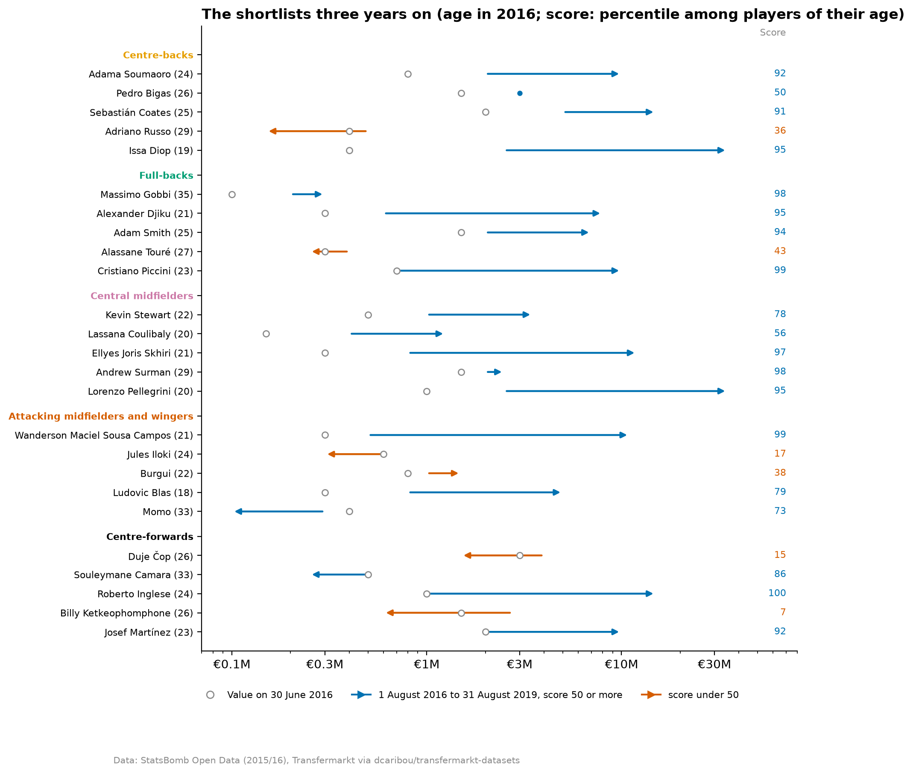
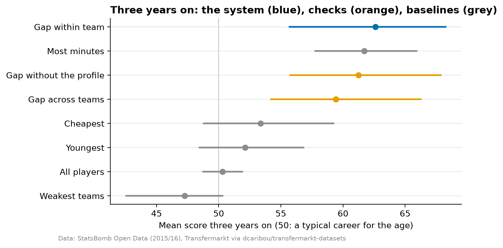
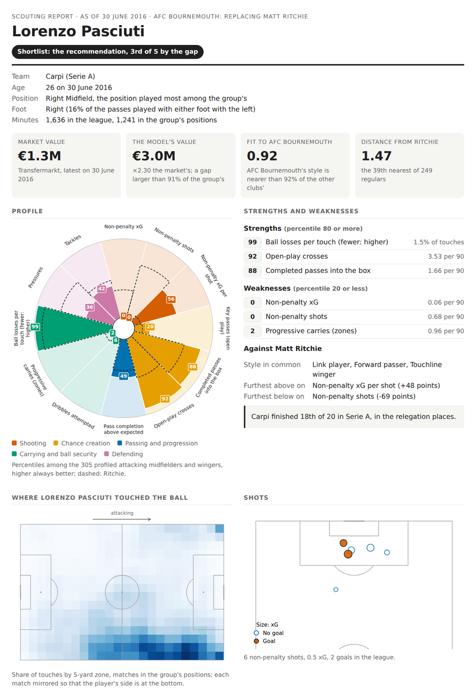
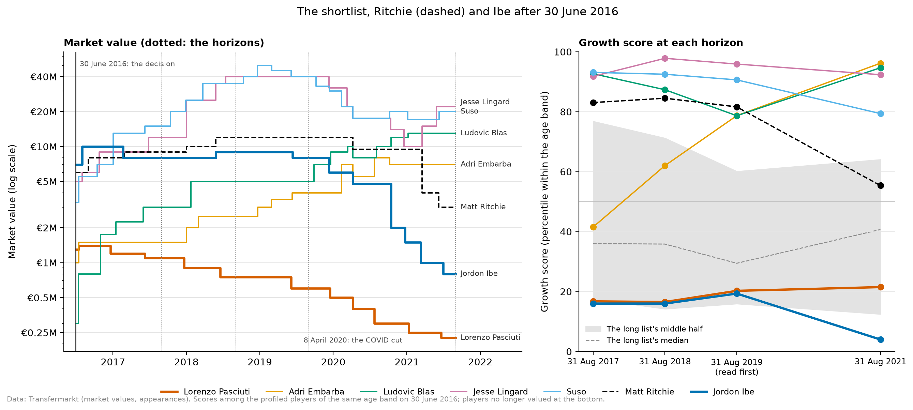
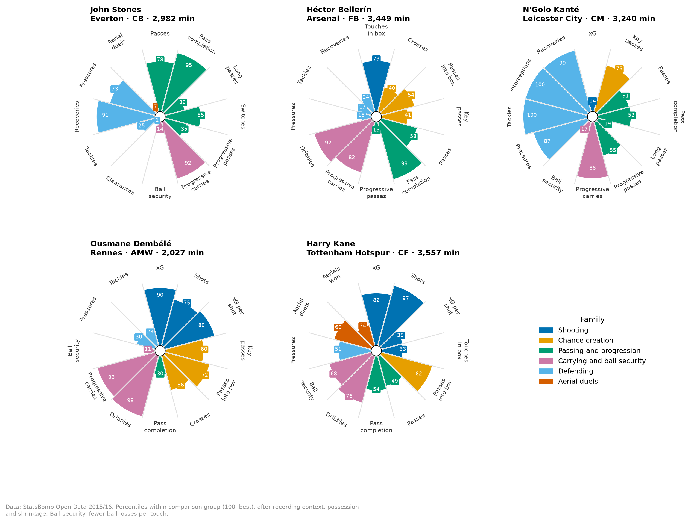
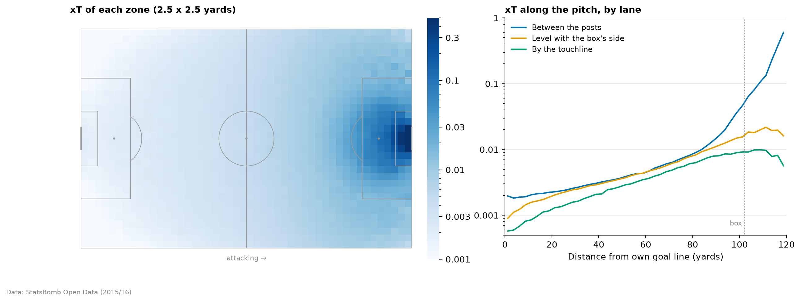
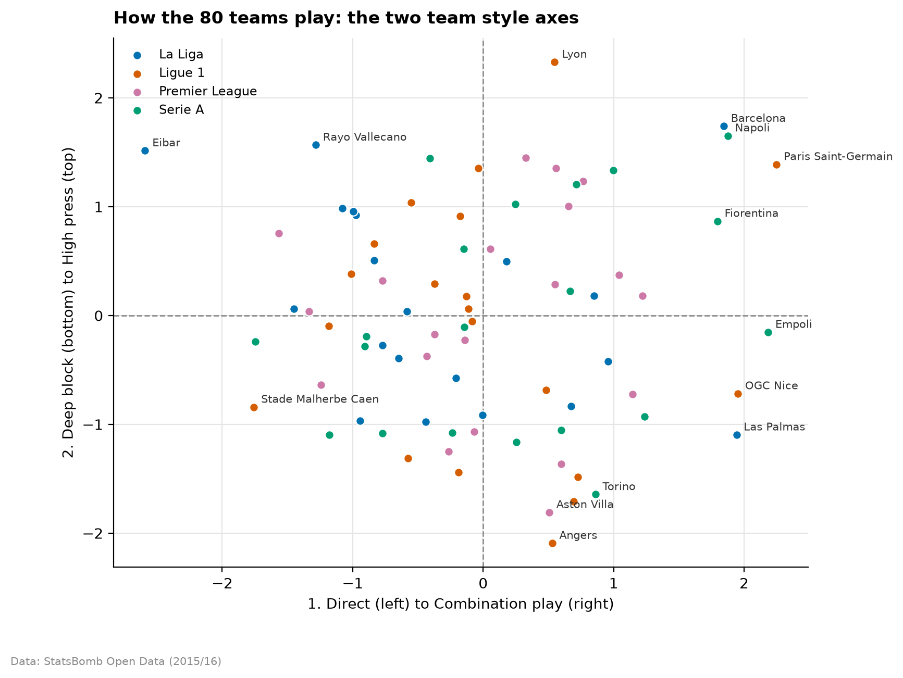
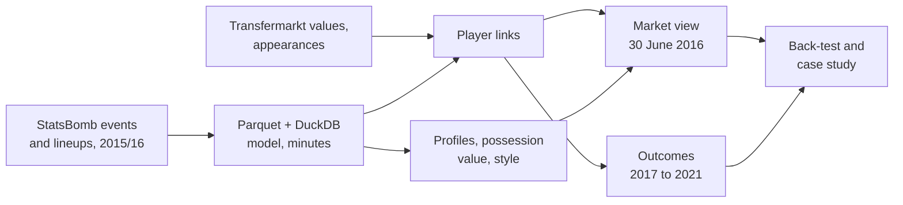

# Football Scouting: a 2015/16 Recruitment Back-test

[](https://github.com/Fabiohhp/football-scouting/actions/workflows/ci.yml)

Using only what was known at the end of the 2015/16 season, which players would a data-driven
scouting system have recommended in four of Europe's top leagues, and how did their careers go?
The season is closed, so every recommendation can be checked against what happened next. StatsBomb
event data from the 1,517 matches of the Premier League, La Liga, Serie A and Ligue 1 describes
how each player played; Transfermarkt values and appearances say what became of them.

**In short**

- **Shortlists drawn up on 30 June 2016 beat the market.** The five players per position group
  the market valued furthest below comparable players, under a €5M budget and away from the
  strongest teams, scored **72.9** three years later on a growth score where 50 is a typical
  career for a player's age, against **48.3** for every player within the same budget (+24.6,
  90% interval 13.1 to 32.6). Their market values went from €21.9M to €188.2M (see the
  [caveats](#caveats)).
- **A worked case: AFC Bournemouth replacing Matt Ritchie.** From 279 candidates to a long list
  of 42, a shortlist of five and one recommendation, with a one-page scouting report per player.
  The shortlist did better than 99.8% of random picks of five from the same part of the long
  list; the recommendation was its one miss.
- **What did not work is reported too.** The event-data profile adds nothing detectable to the
  back-test, a "most minutes" rule matches the system's broadest pick, players do not fall
  into discrete roles, and style fit chose the case study's one miss.
- **Built to be checked.** Features from 2015/16 only and outcomes from later seasons, kept in
  separate tables; every rule fixed and dated before its result was seen
  ([`docs/DECISIONS.md`](docs/DECISIONS.md)); baselines, intervals that resample whole teams, and
  266 automated tests.



## Key findings

### 1. The recruitment back-test ([notebook 04](notebooks/04_recruitment_backtest.ipynb))

**What the market paid for.** On 30 June 2016, age, minutes and league explain 29% to 43% of a
player's market value (log), the team's goal difference takes it to 62% to 73%, and twelve
statistics of how the player played add at most 3 percentage points more. The market paid for context, and
within the profile for attacking output and the ball, not for tackles, interceptions or
pressures.

**The system's signal: the gap within team.** A ridge regression of log value, fitted with each
team's players held out, gives each player the value the market paid for players like them (age,
minutes, league, team strength, profile). The gap is how far below that value the market priced
the player, compared with teammates. Outcomes are scored as a **growth score**: a player's value
growth from 1 August 2016 as a percentile among players of the same two-year age band, those no
longer valued at the bottom.

**The back-test.** The top 10% of each position group by the gap (133 players) reached the 63rd
percentile three years on (90% interval 56 to 68), and 60 to 64 at every horizon from one to five
years. Against baselines a club could have used instead:



**Shortlists a club could have used.** Five players per group, among the 808 valued at €5M or
less outside the strongest fifth of teams: 25 players, young (median 24.5), cheap (median
€0.6M), mostly short of minutes. Three years on they scored 72.9 (60.8 to 81.8) against 48.3 for
all players within the budget, and held up at €2M and €10M budgets, with ten per group and at
every horizon (65.1 to 75.7). Thirteen of 25 scored 90 or more: Issa Diop (Toulouse, €0.4M, to
West Ham at €35M by 2019), Lorenzo Pellegrini (Sassuolo to Roma), Ellyes Skhiri, Roberto Inglese,
Cristiano Piccini. Six scored under 50, four of them attackers, two from teams already relegated
when a club would have bought them.

### 2. Case study: replacing Matt Ritchie at AFC Bournemouth ([notebook 08](notebooks/08_recruitment_case_study.ipynb))

On 1 July 2016 Bournemouth, 16th in their first Premier League season with the league's smallest
squad value, sold their most-used winger to Newcastle for €12M. The case replays the decision of
30 June 2016 with rules set before any list was drawn up:

- **The vacancy**: a two-way right-sided wide midfielder (87% of league minutes, the 90th
  percentile for ball security, 69th for pressures) at a club that presses high and attacks wide.
- **The budget**: €7.85M of market value, Ritchie's €12M fee divided by the median ratio of fee to
  market value in the Premier League the summer before (1.53).
- **The long list**: right-sided attacking midfielders and wingers aged 27 or under, within the
  budget, outside the strongest fifth of teams, ordered by how alike their style and profile are
  to Ritchie's (the similarity search of [notebook 06](notebooks/06_similarity_search.ipynb)):
  279 candidates, 42 left after the filters.
- **The shortlist**: the five largest gaps within team in the nearer half of the long list (Ludovic
  Blas, Adri Embarba, Lorenzo Pasciuti, Jesse Lingard, Suso).
- **The recommendation**: the shortlisted player whose style fits Bournemouth's best (fit as
  defined in [notebook 07](notebooks/07_team_style.ipynb)): Lorenzo Pasciuti of relegated Carpi,
  €1.3M, fit 0.92.

Every player on the shortlist, Ritchie and the player the club signed (Jordon Ibe) has a one-page
report, rebuilt by `make reports`
([`reports/scouting/`](reports/scouting/index.html); self-contained HTML files to download and
open in a browser):

<p align="center">
  
</p>

**What happened.** Four of the five shortlisted players stood at the 79th percentile or above three
years on: Lingard (96th; Manchester United, €40M), Suso (91st; AC Milan, €40M), Embarba and Blas
(79th), all regulars in the big five leagues. The shortlist's mean, 72.8, was matched by 0.2% of
the 20,349 possible picks of five from the same part of the long list (median 37.3). Pasciuti, the
recommendation, stayed at Carpi outside the top flights and fell to the 20th percentile; Ibe, the
club's actual signing, to the 19th. Ritchie, sold, stood at the 82nd.



### 3. What the data did not support

Negative and modest results, each tested the same way as the positive ones:

- **The event-data profile adds nothing detectable to the back-test.** The value model without
  the twelve statistics picks 99 of the same 133 players and scores 61.3; its shortlists 72.6. The
  edge comes from the market pricing a player below players of the same age, minutes, league and
  team, not from the profile.
- **A simple rule does as well at the top 10%.** The players with the most minutes in 2015/16
  score 61.7. In the shortlists the gap is 7.3 points ahead of most minutes, but the interval
  crosses zero.
- **There are no discrete player roles.** Mixtures of two to seven roles do not reproduce on
  random halves of the players (agreement at most 0.57, against 0.6 required); style is a
  continuum, read on three or four named axes per group
  ([notebook 05](notebooks/05_role_discovery.ipynb)). No axis predicts value growth after Holm's
  correction (0 of 34), and the market priced no style beyond a player's numbers.
- **Clubs did not replace like for like.** Their 2016/17 signings were no nearer in style to the
  player who left than chance; the pairs follow the club's price level instead
  ([notebook 06](notebooks/06_similarity_search.ipynb)).
- **Fit to a team's style predicts minutes only where the coach stayed** (a share of the club's
  league minutes 0.24 higher from the worst fit to the best, 107 signings), a split found during the analysis; over
  all signings the effect is within chance ([notebook 07](notebooks/07_team_style.ipynb)). In the
  case study the best fit was the worst career.
- **How a player responds to the opponent's style is not reliable over one season**, so line-ups
  cannot be fitted to it from this data ([notebook 07](notebooks/07_team_style.ipynb), section 5).

### 4. Methods built along the way

- **Data quality** ([notebook 01](notebooks/01_data_exploration.ipynb)): minutes rebuilt from
  lineups, substitutions and dismissals (four data problems found and fixed); StatsBomb and
  Transfermarkt players linked with no shared IDs, 2,277 pool players with at most about three
  wrong, checked on goals, cards and minutes (99.96%, 99.79% and 99.52% agreement over 42,056
  player-matches). The Premier League recorded about three times the interceptions from
  28 December 2015, so defensive numbers are compared within recording context.
- **Player profiles** ([notebook 02](notebooks/02_player_profiles.ipynb)): twelve statistics per
  position group, chosen for reliability and redundancy; possession adjustment measured within
  players (it predicts the change of 31 players who switched teams with a slope of 0.97); rates
  shrunk by their measured reliability, which forecasts the rest of a season 21% to 28% better.

  

- **Possession value** ([notebook 03](notebooks/03_possession_value.ipynb)): an expected threat
  (xT) map that counts ball losses, checked on held-out matches (without them the textbook map
  overstates threat by 46%), and an expected pass completion model (gradient boosting, held-out
  AUC 0.883) that leaves out the end location, which gives an incomplete pass away. Completion as
  recorded mostly measures ease: John Stones falls from the 95th percentile to the 56th, N'Golo
  Kanté rises from the 52nd to the 90th.

  

- **Similarity search** ([notebook 06](notebooks/06_similarity_search.ipynb)): the distance chosen
  by how often a player's two half-seasons find each other (first in 73% of cases among 60 to 156
  players, in the top five in 92%), with filters for age, league, value, foot and side, and the
  style ends and statistics a candidate shares.
- **Team style** ([notebook 07](notebooks/07_team_style.ipynb)): ten team numbers on one scale
  across leagues and recording contexts, two style axes, pass networks; players who changed team
  in January changed style as much as the new team's style predicts (slope 1.00).

  

## Caveats

- **Transfermarkt values, not fees.** They are crowd-sourced estimates, revalued in league
  batches; on 30 June 2016 most were winter values, and by 1 August the shortlisted players had
  already been revalued by a median 1.67 times. The growth score counts from 1 August only; the
  €21.9M to €188.2M is from 30 June, and Diop and Pellegrini are €70M of it.
- **One season, judged once.** Every choice was fixed before its result and is dated, but there is
  no second season to replicate on; 25 shortlisted players give wide intervals, and the case study
  is one case, not a test.
- **Growth is relative to age.** A veteran who kept a value scores high because most players their
  age stopped being valued. Three years on (31 August 2019) is read first, before the flat COVID
  cut of values on 8 April 2020.
- **Coverage.** Four leagues of StatsBomb's open data (its 2015/16 Bundesliga is Bayer
  Leverkusen's 34 matches only); goalkeepers have no profile. Transfermarkt appearances cover 14
  first divisions, so "no league minutes" does not mean "no career".

## Methodology



- **Pipeline**: raw StatsBomb JSON downloaded at a pinned commit and Transfermarkt tables recorded
  with their checksums (the source overwrites them in place), converted to Parquet, validated
  against the raw files and modelled into documented tables in DuckDB ([`docs/DATA_DICTIONARY.md`](docs/DATA_DICTIONARY.md)). Every step is idempotent and driven
  by one config file ([`config/pipeline.yaml`](config/pipeline.yaml)).
- **No leakage**: the market view is 30 June 2016; values set after it, later appearances and
  transfers are outcomes, stored apart and read only to judge a rule already fixed.
- **Comparisons within position groups**: five comparison groups of outfield players, statistics
  read per 90 real minutes, on one scale across leagues and recording changes, on an even share of
  possession and shrunk towards the group by measured reliability.
- **Uncertainty**: intervals from bootstrap resamples that keep a team's players together, held-out
  teams for every model of value, permutation baselines, and Holm's correction where many tests
  are run.
- **Decisions and evidence**: [`docs/DECISIONS.md`](docs/DECISIONS.md) records each choice with its
  date, its reason and the alternatives tested; [`docs/PROGRESS.md`](docs/PROGRESS.md) the open
  questions.

## Notebooks

| Notebook | Question |
|---|---|
| [01 · Data exploration](notebooks/01_data_exploration.ipynb) | What does the data look like, and can it be trusted? |
| [02 · Player profiles](notebooks/02_player_profiles.ipynb) | Which numbers describe a player? |
| [03 · Possession value](notebooks/03_possession_value.ipynb) | What are passes and carries worth? |
| [04 · Market value and the recruitment back-test](notebooks/04_recruitment_backtest.ipynb) | What did the market miss on 30 June 2016? |
| [05 · Role discovery](notebooks/05_role_discovery.ipynb) | Which role does a player play? |
| [06 · Similarity search](notebooks/06_similarity_search.ipynb) | Who plays like a given player? |
| [07 · Team style](notebooks/07_team_style.ipynb) | How does a team play, and who fits it? |
| [08 · Recruitment case study](notebooks/08_recruitment_case_study.ipynb) | Who should Bournemouth have signed? |

What each one found: [`notebooks/README.md`](notebooks/README.md).

## Reproduce

Requirements: [uv](https://docs.astral.sh/uv/), `make`, about 6 GB of disk and 8 GB of memory.

```bash
make setup             # create the environment from uv.lock (Python 3.12)
make test              # unit tests (also run in CI on every push)
make data              # download (~0.5 GB, ~4.5 GB on disk), convert, validate, report
make model             # analytical tables, links, DuckDB, profiles, dictionary (~3 min)
make dq                # data quality tests on the processed tables
make notebooks         # re-run every notebook in place (~25 min)
make reports           # the case study's scouting reports
```

Rebuilding from the downloaded data reproduces the processed tables and the notebooks' results.
Data is written to `data/` and never committed. Every command, the code conventions and the data
pitfalls found so far are in [`docs/DEVELOPMENT.md`](docs/DEVELOPMENT.md).

## Project layout

```
config/                  pipeline configuration (sources, seasons, groups, back-test dates)
src/football_scouting/   the package: ingestion, data model, analyses, reports, figures
scripts/                 pipeline entry points (Makefile targets)
notebooks/               the analyses, importing from the package
reports/                 README figures, scouting reports, coverage report
tests/                   unit tests (CI) and data quality tests (make dq)
docs/                    decisions, progress, development notes, data sources, data dictionary
```

## Data attribution

<a href="https://statsbomb.com/"></a>

Event data provided by [StatsBomb](https://statsbomb.com/) through its free
[open-data](https://github.com/statsbomb/open-data) repository. Market value, appearance and
transfer data from Transfermarkt via the
[transfermarkt-datasets](https://github.com/dcaribou/transfermarkt-datasets) project. Neither is
redistributed here; full terms in [`docs/DATA_SOURCES.md`](docs/DATA_SOURCES.md).

## Author

Fábio Henrique Peixe ([LinkedIn](https://www.linkedin.com/in/f%C3%A1bio-henrique-peixe/))

## License

The code is released under the [MIT License](LICENSE). The data belongs to its providers and is
used under their terms.
